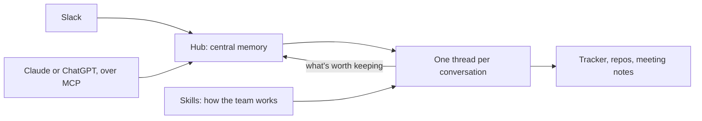

We built an agentic system for our team. It's an agent called Patch that lives in Slack, knows our projects and does the tedious work around them.

It isn't a replacement for Claude or Codex. They write code, and they keep getting better at it. Patch covers what they don't have: our projects, our way of working, and the place where our team already talks.

## What it does

- **Answers questions about a project.** It reads the issue tracker, the GitHub repositories, meeting notes and Slack, so "what's blocking the release?" gets an answer.
- **Keeps the tracker current.** It creates and updates issues and projects when someone asks, so nobody has to copy a decision from Slack into a ticket.
- **Writes the documents nobody wants to write.** Project updates, summaries of what changed, and a daily summary per project.
- **Follows up.** A request can be one-time or recurring, and it comes back when it said it would.

## The design

### Every conversation is its own thread

A conversation with an agent might lead to something, or to nothing. So each one is a thread with its own memory, kept apart from everything else. One thread never reads another. A long, messy conversation can't leak into the next person's answer.

### One central memory

What has to last lives in one place, outside the threads: notes on each project, commitments, schedules and a record of every action. A thread reads from it when it starts, and only what's worth keeping goes back.

### Skills hold the team's way of working

A skill is a folder with instructions and reference files. Ours describe how we set up a project, how we plan it and how we follow up. To change how the agent works, we edit a skill, not the code.

The split is strict. Skills supply judgment and working style. Code owns identity, permissions and recovery.

### Results land where the team already looks

An answer goes in the Slack thread. A change goes in the tracker. A file is saved as a new version, never an overwrite, and the whole team can open it.

## Guard rails

- **Who asked decides what's allowed.** Permission comes from the verified person who made the request, never from the text of a message. The model can't give itself more access.
- **Every write is recorded first.** An action is written to a ledger before it's sent. If the result is uncertain, it's checked against the other system and never sent twice.
- **Turns have a budget.** A turn has limits on steps, tool calls and writes. Unfinished work continues in a later turn.

## Infrastructure

We built it on Cloudflare's [Agents SDK](https://developers.cloudflare.com/agents/). Each idea maps to one piece:

| Idea                         | Cloudflare piece                     |
| :--------------------------- | :----------------------------------- |
| A thread with its own memory | A Durable Object with its own SQLite |
| Central memory and lists     | D1                                   |
| Versioned files              | R2, one new key per version          |
| Every model call             | AI Gateway, with spend limits        |
| Running code                 | A sandbox                            |
| Long tasks                   | Workflows                            |
| Posts to Slack               | Queues                               |

A Durable Object fits a thread well. It wakes when a message arrives, keeps its state through restarts and sleeps while it waits. The platform costs about $6 to $20 a month before model tokens.

## Working with other agents

Claude and ChatGPT can connect to Patch over MCP. A person signs in with Slack, and their requests get the same permissions and the same action ledger as in Slack. So an outside agent can ask about a project, or hand work to Patch, without leaving its own chat.

As those agents improve, we get that for free. Patch keeps the narrow job: the things that are specific to our team, done our way.
