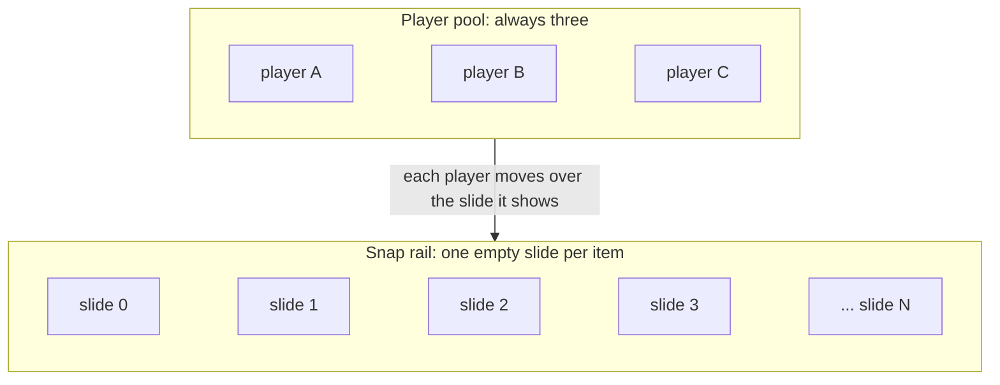
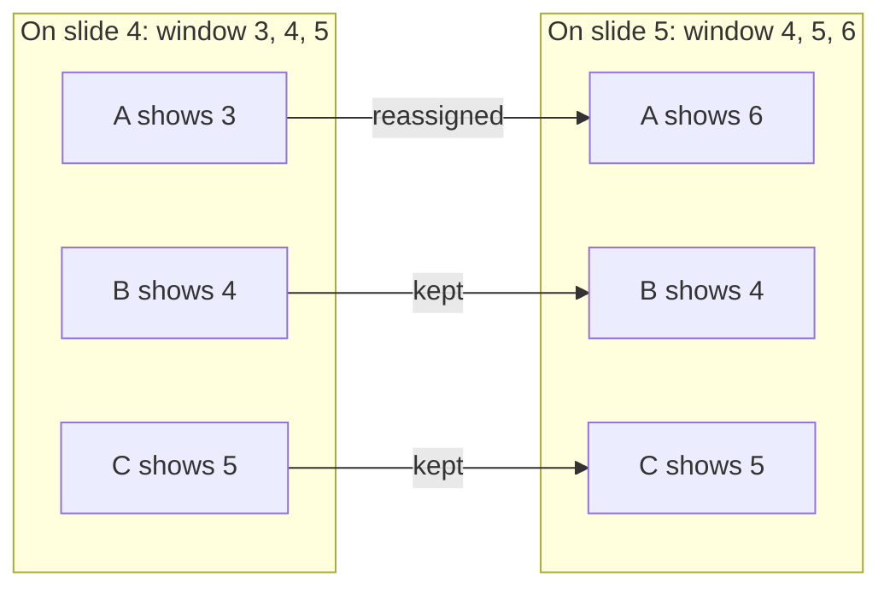

## Update: streams that don't go dead

_November 2026_

The demo used to play a handful of public HLS test streams, from Mux, Bitmovin, THEOplayer and a few others. They kept breaking. Test streams disappear whenever their host cleans up, and a dead link leaves a black slide in the feed.

So I made [hls-demo-streams](https://github.com/harshmandan/hls-demo-streams), a repo that generates its own. There are no video files in it. A GitHub Action runs ffmpeg on every push and publishes the clips to GitHub Pages:

- **120 clips**, 20 each of six patterns: gradients, plasma, a test card, the Mandelbrot set, Game of Life and cellular automata. Each one is drawn by one of ffmpeg's built-in video sources (`gradients`, `testsrc2`, `mandelbrot`, `life`, `cellauto`, or `geq` for the plasma), with a few filters on top.
- **360×640, 24 fps, 6 seconds**, H.264 with no audio, about 120 KB each, and made to loop.
- **A static JSON API**: every stream, every stream of one pattern, and ten fixed shuffles. A static host can't shuffle per request, so the build writes ten shuffled lists and the client picks one.

doomscroller now loads its feed from one of those shuffles. It always uses the same one, so a deep link like `/5` keeps pointing at the same clip. You can browse all the clips in the [gallery](https://harshmandan.github.io/hls-demo-streams/).

<div class="post-divider" role="separator">Original post · October 2024</div>

A TikTok-style feed is a long list of full-screen videos that you swipe through one at a time. The obvious way to build one is a `<video>` element per item, and it falls apart quickly. Every video element can hold a decoder, a buffer of downloaded video and open network requests, and phones run out of all three long before the feed runs out of videos.

doomscroller is my version in SvelteKit. It keeps exactly three `<video>` elements on the page, however long the feed is. Here it is running. Scroll or swipe inside the frame, or [open it full screen](https://harshmandan.github.io/doomscroller/).

<iframe class="demo-frame" src="https://harshmandan.github.io/doomscroller/" title="doomscroller demo" loading="lazy" allow="autoplay; fullscreen"></iframe>

The source is [on GitHub](https://github.com/harshmandan/doomscroller). The rest of this post is how it works.

## Two layers: the scroll and the players

The feed is split into two layers that know very little about each other.

The bottom layer is the **snap rail**: one empty, full-screen `div` per feed item, stacked vertically inside a scroll container with CSS scroll snapping turned on. It has no video in it at all. Its only job is to give the page the right scroll length and let the browser handle the swiping. Momentum and snapping to the next slide both come from the browser, so the feed feels like a native app without any gesture code.

The top layer is the **player pool**: three absolutely positioned slots, each with one `<video>` element. A slot moves to the slide it's showing by setting its `top`, so it sits exactly where that slide would be in the scroll and moves with it.



This split is what lets the feed grow. Each new item adds one empty `div`, which costs the browser almost nothing. The expensive part, the video players, stays at three.

## Why three players

The smallest version of this idea is one video element that changes its source every time you swipe. It works, but every swipe starts from nothing: the browser has to fetch the stream's playlist, download the first chunks and decode a frame before anything shows up. You see a black screen or a spinner on every slide.

Three players cover the slide you're on and one slide in each direction. By the time you swipe, the next video has already started loading in its own player, so it can start almost straight away. Swiping back is just as quick, because the previous slide's player is still holding its video. It plays again from the start.

## Sliding the window

At any moment the pool needs to know which three items to show. That's a window of three indexes around the current slide, and it only needs special handling at the two ends of the feed:

```ts
export function computeWindow(idx: number, len: number): number[] {
	if (len <= 0) return [];
	if (len <= 3) return Array.from({ length: len }, (_, i) => i);
	if (idx <= 0) return [0, 1, 2];
	if (idx >= len - 1) return [len - 3, len - 2, len - 1];
	return [idx - 1, idx, idx + 1];
}
```

On the first slide there's nothing before it, so the window is the first three items. On the last slide it's the last three. Everywhere else it's the current slide and its two neighbours.

## Moving slots without remounting them

When the window changes, the easy thing would be to throw away the three players and make new ones for the new window. That's exactly the slow path the pool exists to avoid: new video elements, new HLS players, and buffers that start empty.

Instead, each slot keeps its index if that index is still in the new window, and only a slot that fell out of the window gets a new one. Swiping from slide 4 to slide 5 changes the window from 3, 4, 5 to 4, 5, 6, so only one slot moves:



Slot A gets slide 6 and starts loading it while you watch slide 5. Slots B and C don't change at all, so the video you're watching and the one you just left keep their buffers.

For this to work, Svelte must never recreate the slot components. Each slot has a fixed id (`'a'`, `'b'` and `'c'`), and the list is keyed by that id instead of by the slide it shows:

```svelte
{#each slots as slot (slot.id)}
	<PlayerSlot item={feed[slot.boundIndex]} active={slot.boundIndex === currentIndex} />
{/each}
```

When a slot's index changes, Svelte sees the same three keys as before, updates the props, and leaves the `<video>` elements where they are. The same three elements live from page load until the page closes.

## Knowing which slide you're on

The whole feed runs off one number: the index of the current slide. It comes straight from the scroll position. Dividing `scrollTop` by the height of the container gives how many slides you've scrolled through, as a fraction.

Scroll events can fire faster than the screen redraws, so the handler only schedules one calculation per animation frame. The listener is also registered as `passive`, which tells the browser it will never cancel the scroll, so the browser can keep scrolling smoothly without waiting for the handler to finish.

The current slide switches once the next slide covers 35% of the screen, not when the snap finishes. That gives the next video a head start: it starts playing while the scroll is still settling.

When that number changes, the page works out the new window, moves the slot that left it, plays the active player and pauses the others, and updates the URL.

## Playing HLS everywhere

The videos are HLS streams. Instead of one big file, an HLS stream is a playlist that points to many short chunks, which lets a player start quickly and switch quality as the connection changes.

Safari can play HLS on its own: you set the video's `src` to the playlist and it works. Most other browsers can't, and need [hls.js](https://github.com/video-dev/hls.js), a library that downloads the chunks itself and feeds them into the video element. hls.js is a big library, so it's only loaded when the browser actually needs it, and only once. Every slot shares the same import.

There's one check here that's easy to miss. Loading hls.js takes a moment on the first visit, and by the time it arrives you may have swiped on and the slot has a different stream. Without a check, the slot would attach the old stream and play the wrong video. So each slot remembers which stream it's meant to show, and ignores anything that finishes late for a different one.

## Keeping the URL in sync

The URL follows the slide you're on, so `/5` opens the feed at the fifth video and sharing a link shares the right video.

Updating the URL can't use SvelteKit's `goto`, because `goto` is a real navigation: it runs the page's `load` again and, by default, adds a history entry for every slide. The feed uses SvelteKit's `replaceState` instead, which changes the URL in place without navigating. One catch: `replaceState` throws if it's called before SvelteKit's router has started, so the feed waits for the first `afterNavigate` before it starts updating the URL.

The route is `[[id]]`, an optional parameter, so `/` and `/5` are the same page. On load, the page scrolls the snap rail to the right slide, and the player pool follows.

The demo runs on GitHub Pages, which only serves static files. The page is prerendered as an empty shell, and any deep link like `/5` falls through to a fallback page that boots the app and reads the slide number from the URL.

## Try it

The [demo](https://harshmandan.github.io/doomscroller/) plays generated clips from [hls-demo-streams](https://github.com/harshmandan/hls-demo-streams). To run it locally:

```sh
git clone https://github.com/harshmandan/doomscroller
cd doomscroller
pnpm install
pnpm dev
```

To try your own videos, point `loadFeed` in `src/lib/feed.ts` at your own streams.
