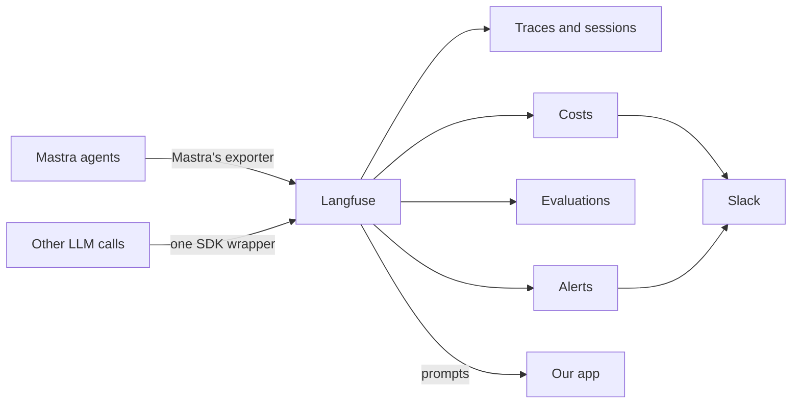

Our app uses LLMs in a lot of places: agents that answer questions about videos, and background jobs that transcribe, translate, summarise and analyse. To see what those calls do and what they cost, we use [Langfuse](https://langfuse.com/docs). It records each LLM call as a trace: the prompt, the response, the model, tokens, cost and timing.

## Setup

Tracing an app with Langfuse needs three things:

- **A Langfuse project and its keys.** We use Langfuse Cloud.
- **A way to send traces.** An agent framework usually has an integration. Everything else goes through the Langfuse SDK.
- **A flush before the process stops.** On serverless, unsent traces are lost when the function is frozen.

Our eight [Mastra](https://mastra.ai/docs) agents send traces through Mastra's Langfuse exporter. About sixty other LLM calls go through one wrapper around the SDK.

## Traces

A long job makes many model calls. We give each run one root span and nest every call under it, so the whole run is one trace with one total cost. Each trace also carries what it was for, such as the feature and the video.

<figure>

<figcaption>A trace in Langfuse: one run, with each model call's timing, tokens and cost under it.</figcaption>
</figure>

## Sessions and feedback

Every request to our assistant carries the user's ID and the conversation's ID. Langfuse groups traces with the same conversation ID into a session, so a whole conversation reads in order. A thumbs up or down on an answer is saved as a score on its trace, so a bad answer leads straight to what the model saw.

<figure>

<figcaption>A session in Langfuse: one conversation with the assistant, turn by turn.</figcaption>
</figure>

## Prompts

Six of our prompts live in Langfuse instead of the code. Our app fetches each one by its `production` label and caches it for two minutes, so a prompt can be changed or rolled back without a deploy. Every prompt also has a copy in the code, used when Langfuse can't be reached.

<figure>

<figcaption>A prompt in Langfuse, with its versions and the production label on the live one.</figcaption>
</figure>

Two things went wrong here:

- **A prompt pinned a retired model.** A prompt can carry its own model setting, and one pointed at a preview model that was later retired. Production broke without a code change. The model now comes from the code.
- **A fallback hid a missing prompt.** One prompt was never created in Langfuse. For five months the app used the copy in the code, and nobody noticed.

## Costs

Langfuse records tokens and cost for every call, and its dashboard shows them by model and over time. I also built a daily digest that reads yesterday's spend from Langfuse's metrics API and posts it to Slack. It flags any feature whose spend moved far from its seven-day median.

<figure>

<figcaption>The Langfuse dashboard: traces, model costs and scores for the past week.</figcaption>
</figure>

## Evaluations

Each managed prompt has a dataset of example inputs. A new prompt version is run against it and scored before it replaces the old one. For the text analysis prompt, the keyword entity preservation score went from 0.17 on the first version to 0.94 on the second.

<figure>

<figcaption>Experiments in Langfuse: each prompt version scored against the same dataset.</figcaption>
</figure>

For the assistant, we replay real conversations against new prompts and models. In production, twelve rules use an LLM as a judge to score live traces.

## Alerts

Seventeen Langfuse monitors watch latency, errors, cost, missing data and unexpected models, and post to Slack. The unexpected-model alert caught a prompt being moved to a new model from the Langfuse UI.

<figure>

<figcaption>The alerts page in Langfuse: one monitor per feature and metric.</figcaption>
</figure>

## What went wrong

- **Serverless dropped traces.** A function can be frozen as soon as it responds. Every span now flushes when it ends.
- **Sending every span was too much.** When we first moved to OpenTelemetry, every span our app made landed in Langfuse, about 26,000 low-value traces a month. We took it out, and brought it back later with one setup shared by Langfuse, Sentry and Google Cloud Trace.
- **A loose version range broke production.** It let in a newer OpenTelemetry exporter that crashed cold starts in four functions and lost traces in the rest. I pinned it.
- **Nobody checked that traces arrived.** One server never loaded its tracing setup, and its traces were missing for a month.

One thing went right. Langfuse changed its data model, with a cutoff for the old one. Because every call went through one wrapper, I rewrote the wrapper and the 63 call sites stayed as they were.
