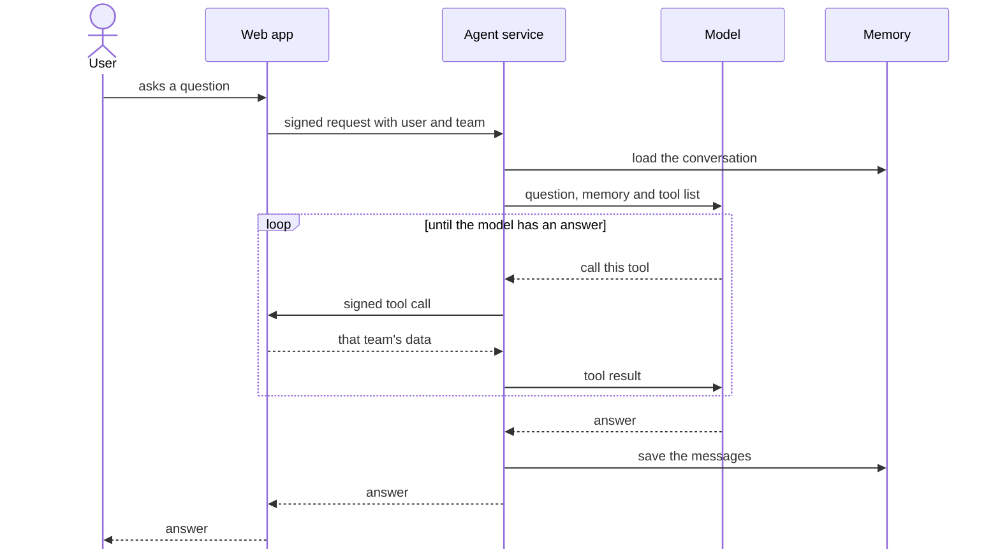

To add an AI assistant to our app, we chose to build it on top of [Mastra](https://mastra.ai/docs), a TypeScript framework for agents. The assistant answers a team's questions about their videos and what viewers thought of them.

## Infrastructure

An assistant like this needs four things around the model:

- **Somewhere to run the agents.** Mastra runs inside an existing Node app, or as its own server with an HTTP endpoint for every agent.
- **A database for memory.** Postgres with pgvector holds both the conversations and the index for recalling them by meaning.
- **A way for tools to reach your data.** Ours call our app's API, so the access rules it already has apply to the agent too.
- **Trust between the two sides.** A separate agent service and the app each have to prove who they are to the other.

We run the agents as their own service on Google Cloud Run, next to our web app.

## How the assistant works

The assistant is one Mastra agent: Gemini 2.5 Flash, a set of instructions and a list of tools. The model never sees our database. It reads each tool's description and picks which ones to call.

A question like "why did people stop watching the second half of this video?" takes several calls. The agent finds the video, pulls the retention trend, reads the comments and moments around the drop, and answers with timestamps.

## What it can do

The agent has 18 tools:

| Area              | What the tools do                                                                 |
| :---------------- | :-------------------------------------------------------------------------------- |
| Finding things    | Search videos, channels and folders by name, or search all videos by meaning      |
| Viewer feedback   | Read comments with their sentiment, and answers to the questions shown to viewers |
| Numbers           | Totals for emotions, keywords, sentiment and ratings, and trends over a video     |
| What's in a video | Captions, moments with timestamps, and the people, themes and brands that appear  |
| Analysis          | A full report on one video, or a comparison of several                            |
| Actions           | Write questions for viewers and add them to a video                               |

## Identifying users

Every tool has to know who is asking. Our web app sends the user and team in headers, and a middleware on Mastra's server copies them into runtime context, which every tool in that request can read.

Headers alone would let anyone claim to be any team. So requests are signed with an HMAC in both directions: the agent service rejects requests our app didn't sign, and our app rejects tool calls the agent service didn't sign.

## Remembering users between conversations

Mastra's memory gives the model three things on each request:

- The last 20 messages of the conversation.
- The 5 older messages most similar to the new one, from any of the person's conversations.
- A short note about the person, which the model keeps up to date.

So a new conversation still knows what someone asked last week and how they like their answers.

## Tool and prompt changes

Each tool result goes back into the model's context on every step, so a smaller result makes every later step cheaper and faster. Cutting one tool down to its most useful fields took 83% off its tokens.

The prompt changed in small steps: use the team's own terms, format timestamps the way people read them, and avoid tables.

## Going beyond a chatbot

The assistant also acts. When someone asks for questions on a video, it hands the request to a second agent. That agent reads the video, finds real facts with Google Search and adds each question at the right timestamp. It replaced an older AI feature in our app.

An agent doesn't need a chat box. It's a function our code can call, and Mastra workflows can pause for a person's approval. Some uses we haven't built yet:

- **Summaries that arrive on their own.** Once a video has enough responses, a workflow posts a summary to the team's Slack channel.
- **Drafts waiting for approval.** When a video is uploaded, an agent drafts the questions, and nothing goes live until the owner accepts them.
- **Alerts on change.** A weekly job flags a video where viewers dropped off or sentiment fell.
- **Answers inside the page.** An "explain this" button next to a chart shows a short explanation in place.

## Inside our app

The assistant opens as a panel over the page, or as a full page. Past conversations are listed by title, and the loading message shows each tool the agent is calling.
